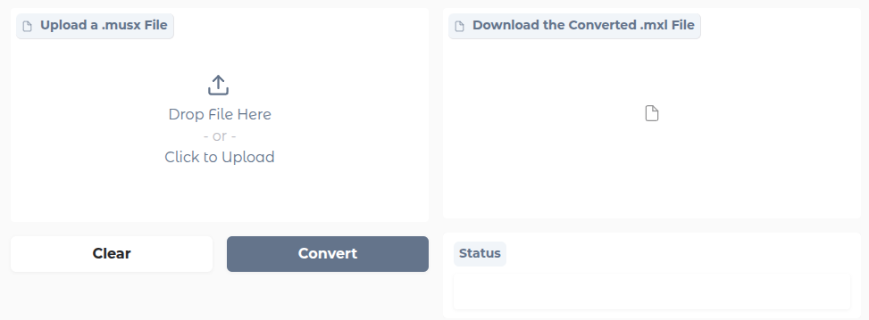
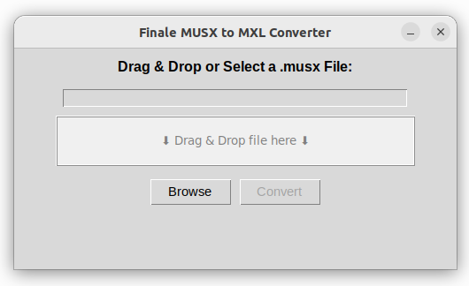

# musx2musicxml 1.0

Turns **Finale files (.musx)** into **MusicXML (.mxl)**, so the music opens in Dorico, MuseScore, Sibelius
and other notation programs. You do not need Finale installed.

> **Fork notice.** This is a fork of [musx2mxl](https://github.com/joris-vaneyghen/musx2mxl) by Joris Vaneyghen
> (MIT License, see LICENSE). All credit for the original converter is his. This fork adds support for files
> saved by Finale 26 and later. Details are under "What 1.0 changes" below.

## Quick start (no programming needed)

You do this once, and it takes about ten minutes.

### 1. Install Python

- Go to <https://www.python.org/downloads/> and click the big yellow **Download Python** button.
- Open the file you downloaded and follow the steps.
  - **Windows:** on the first screen, tick **"Add python.exe to PATH"** before you click Install.
  - **Mac:** just click Continue / Install all the way through.

### 2. Download this converter

- On this GitHub page, click **Releases** (right-hand side), then **musx2musicxml-1.0.0.zip**.
- Leave the zip file in your Downloads folder. You do not need to unzip it.

### 3. Install the converter

- **Mac:** open **Terminal** (press Cmd+Space, type *Terminal*, press Return).
  **Windows:** open **Command Prompt** (press the Windows key, type *cmd*, press Enter).
- Type the line below, then a space. **Don't press Enter yet.**
  - Mac: `python3 -m pip install`
  - Windows: `py -m pip install`
- Drag the zip file from your Downloads folder into the Terminal / Command Prompt window. Its location gets typed in for you.
- Now press Enter. Wait until it says **Successfully installed**.

### 4. Convert music

Each time you want to convert, open Terminal / Command Prompt and type:

- Mac: `python3 -m musx2mxl.musx2mxl_gui`
- Windows: `py -m musx2mxl.musx2mxl_gui`

A small window opens. Drag a `.musx` file onto it, or click **Browse**, then click **Convert**.
The new `.mxl` file is saved **in the same folder as the original**, with the same name.
Your Finale file is never changed.

In Dorico, use **File > Import > MusicXML** and pick the `.mxl` file.

### Converting a whole folder at once

Type this line, then a space, then drag the folder in, then press Enter:

- Mac: `python3 -m musx2mxl --recursive`
- Windows: `py -m musx2mxl --recursive`

Every `.musx` in that folder, and in the folders inside it, gets an `.mxl` next to it.

## What converts, and what does not yet

We tested this against real Finale 27 charts, measure by measure, counting every mark in Finale and in the MusicXML.

**Converts, checked by count on the test charts:** measures (no overfull bars), tuplets (triplets etc.),
grace notes, articulations (staccato, accent, tenuto, marcato ...), dynamics, hairpins, tempo marks with
playback tempo, rehearsal marks, repeat barlines, 1st/2nd endings, chord symbols, grand-staff (piano) parts.

**Handled by the converter but not yet counted by our tests:** notes and rests themselves, ties, key and time
signatures, clefs, lyrics. Check these by eye.

**Not yet:** 8va / 8vb lines, D.S. / D.C. / segno / coda / fine, slurs were not tested (no sample had them),
glissandos, slash / rhythm notation, cue notes, and exact page layout (where systems and pages break).
After import, the notation program lays the music out its own way.

**Please check every piece by eye after converting.** If something looks wrong, note the piece name and the
measure number. That is exactly the feedback that gets it fixed.

## What 1.0 changes (compared with upstream musx2mxl 0.2.9)

- Reads Finale 26+ **SMuFL** fonts: articulations, dynamics, tempo marks and chord-symbol glyphs (°, ø, ♭, ♯, brackets) are no longer dropped.
- Exact tuplet durations, so no overfull measures. Empty staves get a correct whole-measure rest.
- Playback tempo is written as `<sound tempo>`. On piano parts, tempo marks are written once (they used to be doubled).
- 1st/2nd endings are read from Finale's ending data (numbers and lengths), not guessed by counting.
- Right-hand barlines and repeats are written once per measure on grand staves.
- Auto-sequencing rehearsal marks (A, B, C ... / 1, 2, 3 ... / measure numbers) are converted.
- Packaging: installs as `musx2musicxml`, and `lxml` is no longer pinned to an old version that would not install on current Python.

---

*Everything below is the upstream musx2mxl README, kept for reference. Note: `pip install musx2mxl` installs the
**upstream** version from PyPI, without this fork's fixes. Use the Quick start above instead.*

## Upstream: Finale to MusicXML Converter

[](https://github.com/joris-vaneyghen/musx2mxl)

## About
This project is a private initiative aimed at musicians and composers who no longer have a valid Finale license and have no other alternative than the built-in Finale export function. This converter allows users to transform **Finale (.musx) music scores** into **MusicXML (.mxl) format**, making it possible to import them into various music notation software.

**Note:** This converter currently supports only **basic notations** and does not guarantee the exact preservation of bar positions, note placements, and other advanced notations. It is still a **work in progress**.


## Online File Converter

Easily convert Finale `.musx` files to `.mxl` format online.

**[online musx2xml converter](https://jorisvaneyghen-musx2mxl.hf.space/)**.



## Run Online File Converter Locally Using Docker
You can run the online converter on your own machine using Docker.

### Prerequisites
Make sure you have the following installed:
- **Docker** ([Install Docker](https://docs.docker.com/get-docker/))

### Running the Converter
```sh
docker run -it -p 7860:7860 --platform=linux/amd64 \
    registry.hf.space/jorisvaneyghen-musx2mxl:latest python app.py
```
After running the command, open your web browser and go to: [http://localhost:7860/](http://localhost:7860/)

For implementation details, check the **[Git repository](https://huggingface.co/spaces/jorisvaneyghen/musx2mxl/tree/main)**.


## Desktop application

### Prerequisites
Make sure you have the following installed:
- **Python 3** ([Install Python](https://www.python.org/downloads/))
- **pip** (comes with Python but can be updated via `python -m ensurepip` or `python -m pip install --upgrade pip`)

### Install

To install the required package on your local system:
```sh
pip install musx2mxl
```

###  Usage

#### Graphical Interface (GUI)
Run the GUI version with following command in console:
```sh
musx2mxl-gui
```


#### Command Line Execution (Batch Processing)
You can also run the converter via the command line:
```sh
musx2mxl [options] input_path
```

##### Arguments
```
  input_path        A Finale file (*.musx) or a directory containing several Finale files.
```

##### Options
```
  -h, --help        Show this help message and exit.
  --output_path     Specify the output .mxl file path (default: same as input but with .mxl extension). Ignored if input_path is a directory.
  --keep            Keep the decoded Finale data (*.enigmaxml) and uncompressed MusicXML (*.musicxml).
  --recursive       Scan subdirectories recursively if input_path is a directory.
```

## Supported Music Notation Software
MusicXML is a widely used format, and many music notation programs support importing it, including:
- **MuseScore** (https://musescore.org)
- **Sibelius** (https://www.avid.com/sibelius)
- **Dorico** (https://www.steinberg.net/dorico)
- **Notion** (https://www.presonus.com/products/Notion)
- **Capella** (https://www.capella-software.com)

For more details about MusicXML, visit: **[MusicXML Official Website](https://www.musicxml.com)**

## Implementation
The development of this converter is based on earlier work from the following open-source projects:
- **MUSX Document Model ([Robert G. Patterson](https://robertgpatterson.com)):** [GitHub Repository](https://github.com/rpatters1/musxdom)
- **Project-Attacca:** [GitHub Repository](https://github.com/Project-Attacca/enigmaxml-documentation)
- **Denigma:** [GitHub Repository](https://github.com/chrisroode/denigma)
- **Finale PDK Framework:** [Documentation](https://pdk.finalelua.com)
- **Finale Chord suffix lib:** [Downloads](https://www.rpmseattle.com/file_downloads/finale/110924_chords-by-numbers/)

## Disclaimer
This project is not affiliated with **Finale** or **MakeMusic** in any way. For official Finale software and support, please visit: **[Finale Official Website](https://www.finalemusic.com)**.

## License
This project is licensed under the **MIT License**, allowing free use, modification, and distribution. See the LICENSE file for more details.

